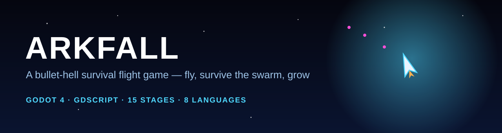

<p align="center">
  
</p>

# ARKFALL — The Last Sky

A **bullet-hell survival flight game** made in **Godot 4**. You fly across an endless sky with the mouse,
your weapons fire on their own, and the swarm keeps coming. Collect crystals, level up, and pick a card each
time; every run earns permanent **pilot points** that carry over.

> 🇹🇷 Tam Türkçe sürüm notları: [README.tr.md](README.tr.md)

## ▶️ Play it

**[Download the Windows build](../../releases/latest)** — unzip and run `ARKFALL.exe`.
(If Windows SmartScreen appears: *More info → Run anyway*.)

To run from source, you need Godot 4:
```
winget install GodotEngine.GodotEngine
```
Then open the project with `Godot Editorde Ac.bat`, or just play with `Oyunu Baslat.bat`.

## Controls

| Action | Key |
|---|---|
| Fly | Mouse (the plane follows the cursor), or WASD / arrows |
| Fire | Automatic |
| Dash (Lightning plane only) | Right click / Space / Shift |
| Pick a card | Click, keys 1–4, or arrows + Space |
| Pause / Fullscreen | Esc / F |
| Gamepad | Left stick to fly, A/RB to dash, Start to pause |

## Features

- **15 stages across 5 operations**, each region introducing a new enemy type.
- **20+ enemy types** with distinct AI (chasers, snipers, healers, splitters, shielded, hive, armored tank…)
  and **boss fights** with a second phase and an enrage.
- **Build variety**: 12 weapons, 12 passives, 12 evolutions, curses, tactics cards, and per-plane mastery.
- **Cosmetics**: a paint shop with 19 parts per plane (paints, trails, exhaust, emblems), earned with tokens
  from Endless mode.
- **Environmental hazards** from stage 6 on: ice, turbulence, synthetic lightning, lava, satellite debris…
- **Its own art, music and sound**: 3D cutscenes and backgrounds rendered from Blender + code, a synthesized
  soundtrack per operation, and real recorded jet sounds (credited below).
- **8 languages**: full Turkish & English, plus German, French, Spanish, Portuguese (BR), Russian, Chinese UI.
- **Endless mode** with its own leaderboard.

## Screenshots

<!-- Drop in-game screenshots in screenshots/ (e.g. gameplay.png, boss.png) and uncomment: -->
<!--  -->
<!--  -->

## Credits & assets

The code, art and music are mine. Some sound effects are Creative Commons (CC BY) and the fonts are under the
SIL Open Font License — all listed in [CREDITS.md](CREDITS.md). Those third-party assets keep their own
licenses; see [NOTICE](NOTICE).

## ⚠️ Disclaimer

This game is provided **"AS IS"**, with no warranty of any kind, under the Apache 2.0 license. The author
accepts **no liability** for any damage or consequence arising from downloading or running it.

> 🇹🇷 **Sorumluluk reddi:** Bu oyun hiçbir garanti verilmeden "olduğu gibi" sunulur; indirilmesinden veya
> çalıştırılmasından doğan hiçbir zarardan geliştirici sorumlu değildir.

## License

Game code and original assets: [Apache License 2.0](LICENSE) © 2026 Miraç Yusuf Y.
Third-party sounds and fonts are under their own licenses (see CREDITS.md / NOTICE).
